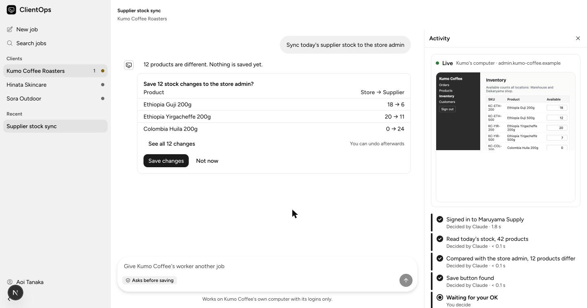
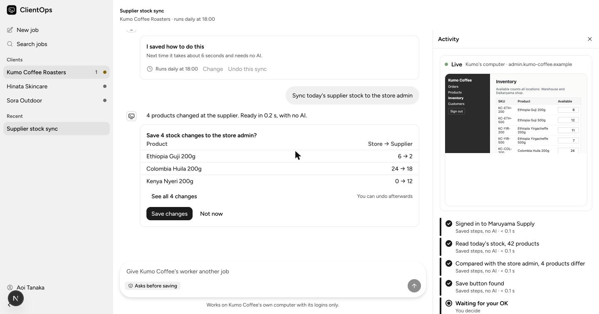
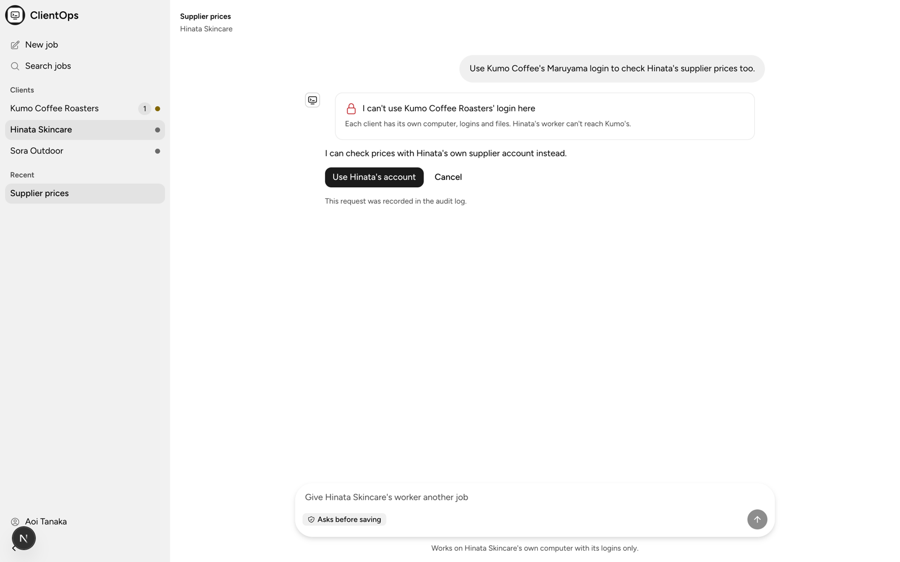
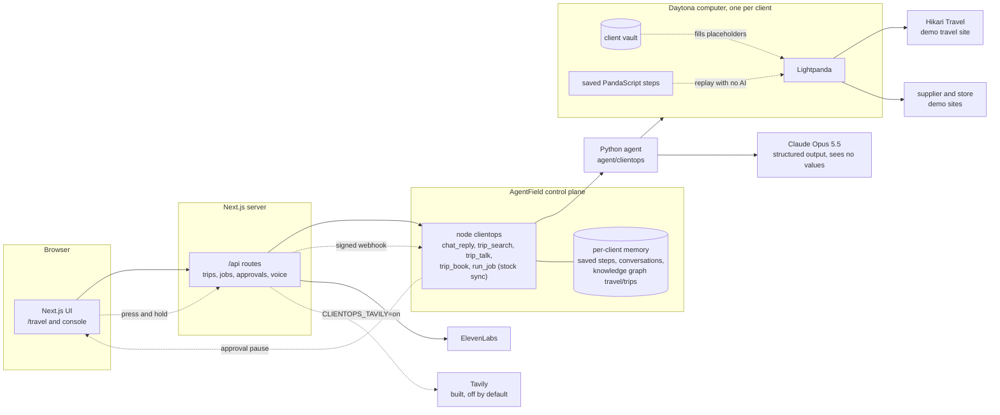

# GoodTravel

A voice-first business-travel concierge whose AI worker runs on each client's own Daytona computer, books only after a person presses and holds the ticket (an AgentField approval), and replays learned steps with no AI.

Built for Agent Forge Tokyo (2026-11-14). The code and internal docs use the engine's name, ClientOps.

## What it does

- You say where you need to be. A concierge answers by voice (ElevenLabs) and moves the trip forward with big photos, a seat map and one ticket.
- The worker runs on the client's own Daytona computer, signs in to the travel site with that client's stored login, and reads real pages with Lightpanda. The login never reaches the AI.
- Claude Opus 5.5 picks the next step, the flight and the seat from what you said and from the client's knowledge graph of past trips (month, purpose, traveller habits).
- Nothing is booked until a person presses and holds the ticket. That hold is an AgentField approval.
- Each booking teaches the graph, and the search steps are saved so the next search replays them with no AI.

## Demo flow

1. **Where to?** The opening writes itself by hand. The city list is ordered by the knowledge graph (in November, Singapore comes first).
2. **Local guide.** Mei, the Singapore guide, introduces her city.
3. **Live search.** "I need to be in Singapore next Saturday for a trade show." The search starts on the client's Daytona computer. The trail shows each step in milliseconds, replayed from saved steps with no AI.
4. **Suggestion.** The worker recommends a flight and an exit-row aisle seat from the traveller's habits in the knowledge graph.
5. **Press and hold.** "Book it." Holding the ticket sends the AgentField approval.
6. **Booked.** The worker confirms on the live site and re-reads the page as confirmed, a mail draft opens (we never send mail ourselves), and the trip is added to the knowledge graph.

## The engine it shares with ClientOps

GoodTravel runs on the same engine as ClientOps, a console where an operations lead talks to one AI worker per client. Its first scene is supplier stock sync:

- **Learn, approve, replay.** The worker reads the supplier portal and the store admin, finds the changes, stops for the person's OK, writes, checks every row and saves the steps. The next run replays them as one script with no AI.
- **Rename repair.** When a page changes, only the broken step climbs a ladder: saved script, then find again by role and name in the page tree, then Claude, then the person. The fixed steps are saved as a new version.
- **Cross-client refusal.** Asking one client's worker to use another client's login is refused and written to an audit log.

## Architecture

- The browser talks only to the app's `/api` routes. Travel uses `src/app/api/trips/` (search, talk, book, insight) and `src/app/api/voice/`; the console uses `src/app/api/jobs/`, `approvals/` and `clients/`.
- Every job is a reasoner on the AgentField node `clientops`. An approval pauses the job; the person's OK comes back as an HMAC-signed webhook and the job resumes.
- Memory is scoped per client: saved steps, conversations and the trip knowledge graph (`travel/trips`).
- Claude is called with a pinned model and a JSON schema. It sees element roles and names and trip features, never logins, names, emails or values.

## Partner technology

| Technology | How it is used | Code |
|---|---|---|
| Daytona | One isolated computer per client from our own pinned snapshot, holding that client's logins in a vault the AI never reads, with an optional per-client network allow list | `agent/clientops/computers.py`, `agent/clientops/boundary.py`, `sandbox/image/` |
| AgentField | The `clientops` node and its reasoners and skills, `app.pause()` approvals resumed by signed webhooks, per-client memory | `agent/clientops/node.py`, `agent/clientops/approval.py`, `agent/clientops/records.py`, `src/lib/agentfieldClient.ts`, `src/lib/tripKnowledgeRoutes.ts` |
| Tavily | Destination insight search, built and tested, switched off for this demo | `src/lib/tavilyRoute.ts`, `src/app/api/trips/insight/route.ts` |
| Claude Opus 5.5 | Conversation turns, flight and seat suggestion, first-run element picking and one-step repair; pinned model, structured output, monthly cost cap per client | `agent/clientops/claude_call.py`, `agent/clientops/trip_talk.py`, `agent/clientops/trip.py`, `agent/clientops/plan.py`, `agent/clientops/repair.py` |
| Lightpanda | The browser inside each computer: reads pages as a semantic tree, replays saved steps as PandaScript | `sandbox/runner/`, `agent/clientops/pandascript.js`, `agent/clientops/trip_pandascript.js`, `agent/clientops/replay.py` |
| ElevenLabs | The concierge's voice | `src/lib/voiceRoute.ts`, `src/app/api/voice/route.ts`, `src/travel/voice.ts` |

## Safety

- Claude never sees logins, names, emails or values. The worker types placeholders, and the client's computer fills them from that client's vault.
- One client can never use another client's login. The request is refused and written to an audit log.
- Nothing is written or booked before a person approves on screen.

## Measured

| What | Time |
|---|---|
| Saved-step replay, local | about 0.45 s |
| Saved-step replay, on Daytona | about 3 to 4 s |
| Conversation turn | about 3 to 4.5 s |
| Voice | about 0.6 s |

## Running it

Needs Bun, uv (Python), Docker and a Lightpanda binary in `vendor/lightpanda/`. Create `.env.local` with the settings listed below; it is never committed.

| Command | What it does |
|---|---|
| `bun install` | Install packages |
| `bun run agentfield` | Start the AgentField control plane (pinned image) in Docker on 127.0.0.1:8080 |
| `bun run agent` | Start the Python agent node `clientops` |
| `bun sandbox/sites/server.ts` | Start the demo sites: supplier (3001), store (3002), Hikari Travel (3003) |
| `bun run lightpanda` | Start Lightpanda on 127.0.0.1:9222 for local computers |
| `bun run dev` | Start the app on http://localhost:3000; the travel scene is at `/travel` |
| `bun run check` | Check the real services (AgentField, Claude, Daytona, Lightpanda) with the keys in `.env.local` |
| `bun run demo:reset` | Put the demo back at the start (needs `CLIENTOPS_DEMO_RESET=on` on the agent) |
| `bun run test` | Unit tests and the agent's Python tests |
| `bun run test:security` | Security tests only |
| `bun run test:ui` | Playwright UI tests |
| `bun run typecheck` / `bun run lint` | Type check and lint |
| `bun run mcp` | MCP server so Claude Code can ask the worker for jobs; approvals stay on the screen |

Settings (names only; put the values in `.env.local`):

| Setting | Meaning |
|---|---|
| `ANTHROPIC_API_KEY` | Claude |
| `DAYTONA_API_KEY` | Daytona |
| `AGENTFIELD_APPROVAL_WEBHOOK_SECRET` | Signs each approval the app sends to AgentField |
| `AGENTFIELD_API_KEY` | Only when AgentField is reachable from other machines |
| `ELEVENLABS_API_KEY`, `ELEVENLABS_VOICE_ID`, `ELEVENLABS_MODEL` | Voice |
| `CLIENTOPS_TRAVEL` | `live` runs the travel scene against the real worker; otherwise it plays back recorded events |
| `CLIENTOPS_COMPUTERS` | `local` runs each client's computer on this machine; unset or `daytona` uses Daytona |
| `CLIENTOPS_EXTERNALS` | `fake` uses documented mocks for Daytona and Claude |
| `CLIENTOPS_JOBS` | `playback` replays the recorded console jobs on screen only |
| `DAYTONA_SANDBOX_ALLOW_LIST` | `on` sends each client's network allow list when its computer is made |
| `CLIENTOPS_TAVILY`, `TAVILY_API_KEY` | `CLIENTOPS_TAVILY=on` turns on Tavily insight search |
| `CLIENTOPS_DATA_DIR` | Where the audit log, settings and costs live (outside the project) |

## Known limits

- The guide videos are pre-made lip-sync clips. A real-time avatar is next.
- The travel site is our own demo site, Hikari Travel, with fictional airlines and a fixed catalog.
- Tavily is built but off in the demo.

## Layout

| Folder | Contents |
|---|---|
| `src/` | Screens and server (Next.js App Router, Astryx); the travel scene is `src/travel/` |
| `agent/` | The worker on AgentField (Python, `uv`) |
| `sandbox/` | What runs inside each client's computer, and the demo sites |
| `e2e/` | Playwright UI tests |
| `scripts/` | Demo reset, stage and restore |
