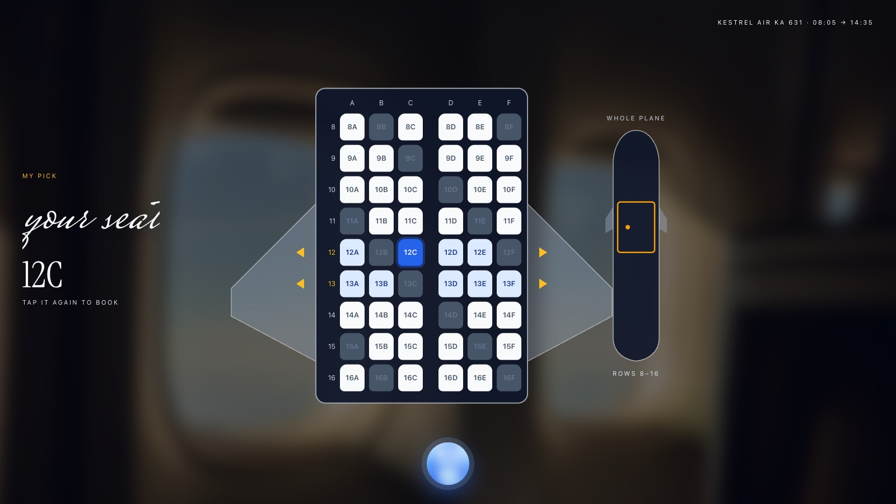
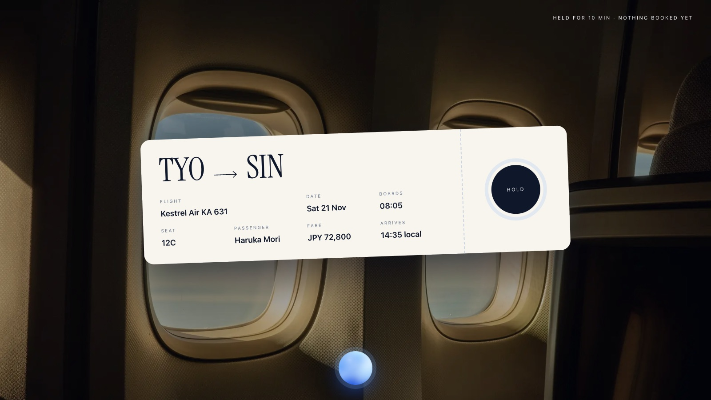
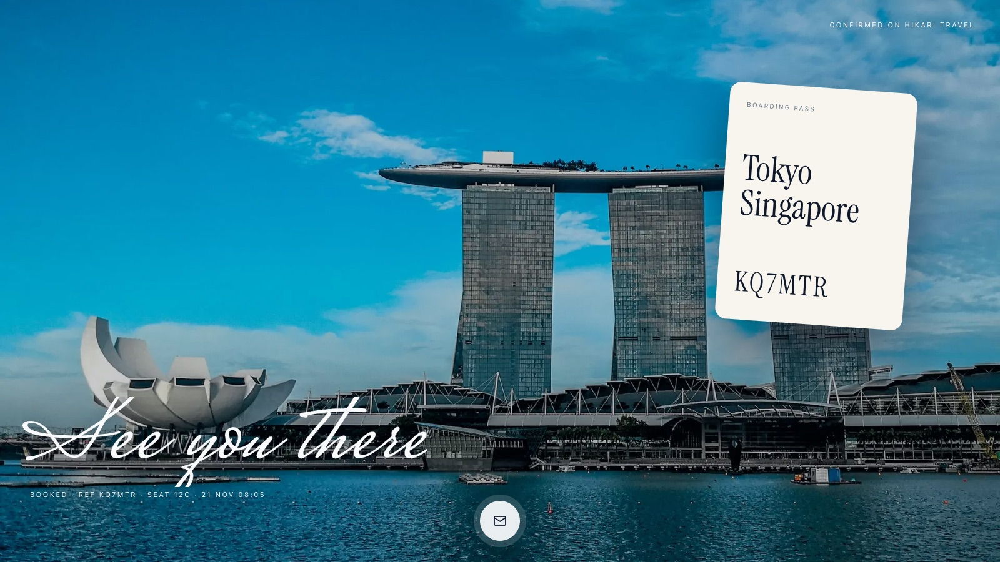
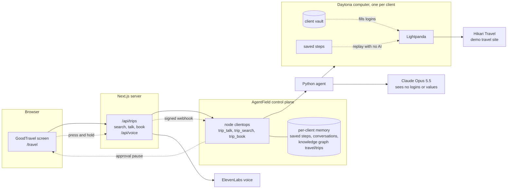

# GoodTravel

Say where you need to be. GoodTravel is a voice-first business-travel concierge: a local guide introduces the city, an AI worker searches the travel site from the client's own Daytona computer, suggests a flight and a seat from past trips, and books only after you press and hold the ticket.

Built for Agent Forge Tokyo (2026-11-14). The code and internal docs use the engine's name, ClientOps.

## The trip, screen by screen

| | |
|---|---|
|  | **1. Where to, and a local guide.** The cities are photos, ordered by a knowledge graph of past trips (month, purpose, habits). Hover a city and its guide starts to talk, lip-synced. |
|  | **2. Live search, then a pick.** “I need to be in Singapore next Saturday.” The worker reads the travel site on the client's Daytona computer while the guide talks, then suggests the flight that arrives first. |
|  | **3. A seat from habits.** The seat map opens zoomed in on the suggestion: 12C, exit row, aisle, more legroom. Say or tap another seat to change it. |
|  | **4. Press and hold to book.** Nothing is booked until you hold the ticket. The hold is an AgentField approval that resumes the worker. |
|  | **5. Booked, and remembered.** The worker books, re-reads the page as confirmed, opens a mail draft, and adds the trip to the knowledge graph. |

The screenshots are from the recorded demo (`/travel?mode=playback`); the passenger and airlines are fictional.

## Why it is fast

- The first search is read by Claude Opus 5.5 and saved as steps. Every later search replays those steps with no AI: about 0.45 s on this Mac and about 3 to 4 s on the client's Daytona computer.
- The search starts as soon as you name a city, so the flights are ready when the guide finishes.
- When a page changes, only the broken step is repaired: page tree first, then Claude, then the person.

## Architecture

- The screen talks only to the app's `/api` routes (`src/app/api/trips/`, `src/app/api/voice/`).
- Every step is a reasoner on the AgentField node `clientops`. Booking pauses at an approval; the hold comes back as an HMAC-signed webhook and the job resumes.
- Memory is kept per client: saved steps, conversations and the trip knowledge graph (`travel/trips`).
- Claude is called with a pinned model and a JSON schema. It sees page roles and names and trip features, never logins, names, emails or card details.

## Why one Daytona computer per client

- **Logins stay inside.** Each client's vault lives on its own computer and fills the fields itself. The AI never sees a password.
- **Clients never mix.** Asking one client's worker to use another client's login is refused and written to an audit log.
- **Ready in seconds.** Every computer starts from our snapshot with the browser and the replay script, so a saved search runs in seconds.
- **A person says yes.** Bookings wait for an approval on screen.

## Partner technology

| Technology | How it is used | Code |
|---|---|---|
| Daytona | One isolated computer per client from our own snapshot, holding that client's logins in a vault the AI never reads | `agent/clientops/computers.py`, `agent/clientops/boundary.py`, `sandbox/image/` |
| AgentField | The `clientops` node and its reasoners, approvals resumed by signed webhooks, per-client memory and the knowledge graph | `agent/clientops/node.py`, `agent/clientops/approval.py`, `src/lib/agentfieldClient.ts`, `src/lib/tripKnowledgeRoutes.ts` |
| Claude Opus 5.5 | Each conversation turn, the flight and seat suggestion, first-run page reading; pinned model, structured output | `agent/clientops/claude_call.py`, `agent/clientops/trip_talk.py`, `agent/clientops/trip.py` |
| Lightpanda | The browser inside each computer: reads pages as a tree, replays saved steps | `agent/clientops/trip_pandascript.js`, `sandbox/runner/` |
| ElevenLabs | The concierge's voice and the guides' lip-synced clips | `src/lib/voiceRoute.ts`, `src/app/api/voice/route.ts`, `src/travel/voice.ts` |
| Tavily | Live local news for each city; built and tested, switched off for this demo | `src/lib/tavilyRoute.ts`, `src/app/api/trips/insight/route.ts` |

## Measured

| What | Time |
|---|---|
| Saved search replayed, local | about 0.45 s |
| Saved search replayed, on Daytona | about 3 to 4 s |
| Conversation turn | about 3 to 4.5 s |
| Voice | about 0.6 s |

## Running it

Needs Bun, uv (Python), Docker and a Lightpanda binary in `vendor/lightpanda/`. Create `.env.local` with the settings listed below; it is never committed.

| Command | What it does |
|---|---|
| `bun install` | Install packages |
| `bun run agentfield` | Start the AgentField control plane in Docker on 127.0.0.1:8080 |
| `bun run agent` | Start the Python agent node `clientops` |
| `bun sandbox/sites/server.ts` | Start the demo sites, including Hikari Travel on 3003 |
| `bun run lightpanda` | Start Lightpanda on 127.0.0.1:9222 for local computers |
| `bun run dev` | Start the app; open http://localhost:3000/travel |
| `bun run check` | Check the real services (AgentField, Claude, Daytona, Lightpanda) |
| `bun run test` | Unit tests and the agent's Python tests |
| `bun run test:ui` | Playwright UI tests |
| `bun run typecheck` / `bun run lint` | Type check and lint |

Settings (names only; put the values in `.env.local`):

| Setting | Meaning |
|---|---|
| `ANTHROPIC_API_KEY` | Claude |
| `DAYTONA_API_KEY` | Daytona |
| `AGENTFIELD_APPROVAL_WEBHOOK_SECRET` | Signs each approval the app sends to AgentField |
| `AGENTFIELD_API_KEY` | Only when AgentField is reachable from other machines |
| `ELEVENLABS_API_KEY`, `ELEVENLABS_VOICE_ID`, `ELEVENLABS_MODEL` | Voice |
| `CLIENTOPS_TRAVEL` | `live` runs the trip against the real worker; otherwise the screen plays back recorded steps |
| `CLIENTOPS_COMPUTERS` | `local` runs each client's computer on this machine; unset or `daytona` uses Daytona |
| `DAYTONA_SANDBOX_ALLOW_LIST` | `on` sends each client's network allow list when its computer is made |
| `CLIENTOPS_TAVILY`, `TAVILY_API_KEY` | `CLIENTOPS_TAVILY=on` turns on live local news |

## Known limits

- The guide videos are pre-made lip-sync clips. A real-time guide that talks back is next.
- The travel site is our own demo site, Hikari Travel, with fictional airlines.
- Tavily is built but off in the demo.
- The same engine also runs back-office work for other clients, such as a supplier stock sync.
